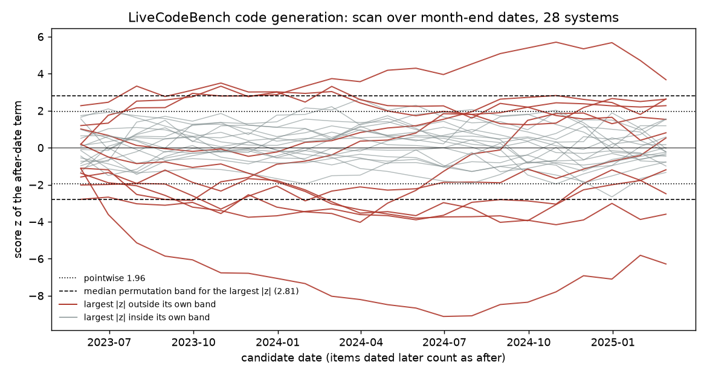

# datecut

Given per-item benchmark results and each item's creation date, datecut compares a system's
success before and after a cutoff date, adjusted for item difficulty and source and set
against the other systems' gap on the same items, with intervals and a scan over candidate
dates.

## Why this is hard

Later benchmark items differ from earlier ones in source and difficulty, so a raw
before-and-after gap mixes whatever the cutoff did with ordinary drift: on the public data
below every one of 28 systems scores lower on later items, and the later items are harder.
The fair comparison is against other systems on the same items and within strata of
similar items. The cutoff itself is often unknown, and choosing the date with the largest
gap inflates that gap unless the search over dates is part of the null distribution.

## Install

```
pip install git+https://github.com/vipul21435/datecut
```

Python 3.10 or later; the dependencies are numpy and scipy.

## Input

- results: one row per (item, system) with a `score` that is 0/1 or a number in [0, 1];
  repeated rows for one (item, system) are averaged
- metadata: one row per item with a `date` (`YYYY-MM-DD`) and optional stratum columns
  such as the source repository or category
- one `--cutoff` date, or a table with columns `system, cutoff` passed as `--cutoffs`

CSV, TSV, JSON and JSON Lines files are read; column names can be changed with
`--item-col`, `--system-col`, `--score-col` and `--date-col`. Items dated strictly after
the cutoff count as "after". Without `--system` every system is analysed and the p-values
in the table are also given after a Benjamini-Hochberg adjustment across systems.

## Quickstart

`examples/data/` holds a synthetic benchmark written by `python examples/make_example.py`:
600 items, 8 systems, later items harder for every system, and one system (`sys-0`) with an
extra drop on items dated after 2024-01-01.

```
$ datecut summary --results examples/data/results.csv --meta examples/data/meta.csv \
    --cutoff 2024-01-01 --system sys-0 --system sys-4
Gaps in percentage points, after minus before. `removed %` is the share of the plain gap that the difficulty adjustment removes.

| system | cutoff | n before | n after | plain gap | interval | adjusted gap | interval | diff in diff | interval | removed % | p (adjusted) | p (BH) |
| --- | --- | --- | --- | --- | --- | --- | --- | --- | --- | --- | --- | --- |
| sys-0 | 2024-01-01 | 285 | 315 | -21.6 | -28.0 to -15.0 | -17.3 | -23.6 to -11.1 | -11.9 | -18.5 to -5.3 | 20 | <0.0001 | <0.0001 |
| sys-4 | 2024-01-01 | 285 | 315 | -11.1 | -18.8 to -3.2 | -3.3 | -10.8 to +4.3 | +0.0 | -7.2 to +7.7 | 70 | 0.3940 | 0.3940 |
```

The plain gap is negative for both systems. The adjusted gap and the difference in
differences stay clearly negative only for `sys-0`.

When the date is not known, scan for it:

```
$ datecut scan --results examples/data/results.csv --meta examples/data/meta.csv \
    --system sys-0 --max-points 8
Scan statistic: largest |z| of the after-date term over the candidate dates; 1000 permutations of item dates across all items, seed 0.

| system | items | candidate dates | best date | largest \|z\| | 95 % permutation band | p (maximum) | p (BH) |
| --- | --- | --- | --- | --- | --- | --- | --- |
| sys-0 | 600 | 8 | 2023-11-26 | 5.28 | 2.66 | 0.0010 | 0.0010 |

| candidate date | n before | n after | plain gap | adjusted gap | pointwise interval | z | outside band |
| --- | --- | --- | --- | --- | --- | --- | --- |
| 2023-01-29 | 20 | 580 | -19.0 | -13.6 | -33.1 to +5.8 | -1.57 | no |
| 2023-05-02 | 98 | 502 | -16.8 | -13.1 | -22.2 to -4.1 | -3.13 | yes |
| 2023-08-12 | 183 | 417 | -17.6 | -13.8 | -20.9 to -6.6 | -4.03 | yes |
| 2023-11-26 | 261 | 339 | -22.0 | -17.1 | -23.5 to -10.7 | -5.28 | yes |
| 2024-02-26 | 333 | 267 | -19.5 | -16.5 | -22.5 to -10.5 | -5.08 | yes |
| 2024-06-05 | 419 | 181 | -15.2 | -14.0 | -20.1 to -8.0 | -3.99 | yes |
| 2024-08-28 | 494 | 106 | -16.0 | -14.7 | -21.3 to -8.1 | -3.41 | yes |
| 2024-11-25 | 580 | 20 | -17.2 | -15.9 | -27.8 to -4.0 | -1.61 | no |
```

The same analyses are available from Python; see `examples/quickstart.py`.

## Commands

Every command takes `--results`, `--meta` and `--format markdown|json`.

| command | what it reports |
| --- | --- |
| `datecut gap` | success before and after, the difference with a Newcombe interval, the counts on each side |
| `datecut strata --strata COL` | Mantel-Haenszel common odds ratio across strata, its interval, a test of homogeneity |
| `datecut did` | the system's gap minus the gap of the pool of other systems, bootstrap interval (`--cluster` resamples whole strata) |
| `datecut adjust` | post-cutoff coefficient of a logistic model with a difficulty covariate from the other systems |
| `datecut scan` | the adjusted gap over a grid of candidate dates, with a permutation band for the maximum |
| `datecut trend` | success against item date in rolling or calendar windows, for the system and the pool |
| `datecut power` | the smallest drop or rise the counts could detect at 80 % power |
| `datecut summary` | plain, adjusted and difference-in-differences gap side by side |

`gap`, `strata`, `did`, `adjust`, `power` and `summary` need `--cutoff` or `--cutoffs`.
When a side of the cutoff has fewer than `--min-side` items (default 20) no gap is
reported and the output says which side is short. `--pool` restricts the reference pool
to named systems; the analysed system is always left out of its own pool.
`--threshold T` turns scores into 0/1 before anything else.

## How it works

Write `y_i` for the system's score on item `i`, `after_i` for the indicator that the item
is dated after the cutoff, and `pool_i` for the mean score of the other systems on the
same item (leave-one-system-out).

**Plain gap.** `gap = mean(y | after) - mean(y | before)`. The interval is Newcombe's
hybrid score interval (method 10 in Newcombe 1998), built from the Wilson limits `(l, u)`
of the two proportions: `lower = gap - sqrt((p_a - l_a)^2 + (u_b - p_b)^2)` and
`upper = gap + sqrt((u_a - p_a)^2 + (p_b - l_b)^2)`. The p-value is the pooled
two-proportion z-test.

**Strata.** For stratum `k` with after/before rows and success/failure columns
`[[a_k, b_k], [c_k, d_k]]` and total `n_k`, the Mantel-Haenszel (1959) common odds ratio
is `sum(a_k d_k / n_k) / sum(b_k c_k / n_k)`. Its interval uses the variance of the log
odds ratio from Robins, Breslow and Greenland (1986). The test of a common odds ratio of 1
is the Cochran-Mantel-Haenszel statistic without continuity correction. Homogeneity is
tested with `sum((a_k - E_k)^2 / V_k) - (sum(a_k - E_k))^2 / sum(V_k)`, where `E_k` and
`V_k` are the expected count and its variance under the common odds ratio; the subtracted
term is the correction of Tarone (1985). It is referred to a chi-square distribution with
one degree of freedom fewer than the number of strata.

**Difference in differences.** With `d_i = y_i - pool_i` the estimate is
`mean(d | after) - mean(d | before)`, which equals the system's gap minus the pool's gap.
The interval is a percentile bootstrap over items, resampled within each side of the
cutoff, or over whole strata with `--cluster`. The p-value is twice the smaller share of
resampled estimates on either side of zero.

**Difficulty adjustment.** The model is
`logit P(y_i = 1) = b0 + b1 * after_i + b2 * z_i` with
`z_i = log((s_i + 0.5) / (m_i - s_i + 0.5))`, where `m_i` other systems answered the item
and `s_i` is the sum of their scores. It is fitted by iteratively reweighted least squares
on numpy. `b1` is reported with a Wald interval; when scores are fractional the standard
errors are the HC0 sandwich form. The "adjusted gap" is the same fit on the probability
scale: the mean over items of fitted success with `after = 1` minus fitted success with
`after = 0`, with a delta-method interval. `removed %` is `1 - adjusted gap / plain gap`.

**Cutoff scan.** For each candidate date the score statistic `z` tests the `after` term
against the fitted model without it. The scan statistic is the largest `|z|` over the
grid (or the most negative `z` with `--alternative drop`). Its null distribution comes
from reassigning item dates at random, within strata if `--within-strata` is given, and
repeating the whole scan each time. The band is the 95 % quantile of that distribution, so
a date picked because it looks best is compared with the best-looking date of scans in
which dates carry no information.

**Trend.** Success in rolling windows of `--window` items in date order, or in calendar
periods with `--by`. The system's band is the Wilson interval; the pool's band and the
band of the system-minus-pool difference are normal intervals over the items of the window.

**Power.** The normal approximation to the power of the pooled two-proportion z-test, with
the before rate held at its observed value; the after rate is moved by bisection until the
power reaches 80 %.

**Many systems.** Benjamini and Hochberg (1995) adjusted p-values across the systems in a
table.

Related work behind these choices: Roberts et al. (2023) use training cutoffs as a natural
experiment on benchmarks released over time; Li and Flanigan (2023) compare performance on
datasets released before and after a training-data date while controlling for dataset
difficulty; Cheng et al. (2024) find that an effective cutoff can differ from the reported
one, which is why datecut offers a scan and does not require a date; LiveBench (White et
al. 2024) and LiveCodeBench (Jain et al. 2024) publish dated questions; SWE-bench (Jimenez
et al. 2023) items carry creation dates.

## Results on real public data

All numbers in this section are printed by one command, after the two fetch scripts
(about 10 seconds for the report, measured on a loaded laptop; data fetched on 2026-11-13):

```
python scripts/fetch_livecodebench.py --out data/livecodebench
python scripts/fetch_swebench_verified.py --out data/swebench_verified
python scripts/real_data_report.py --lcb data/livecodebench --swe data/swebench_verified
```

The full output, with every system, is in [results/real_data.md](results/real_data.md).

The split dates used here (2024-06-30 and 2020-12-31) are analysis choices near the middle
of each benchmark's item dates. They are not the training cutoff of any system, and no
training cutoff is used anywhere in this section.

### LiveCodeBench code generation

Source: the per-problem results file that the LiveCodeBench leaderboard page loads
(`https://livecodebench.github.io/performances_generation.json`): 28 systems on 1,055
problems dated 2023-05-08 to 2025-04-07, with each problem's difficulty label and
platform. The score is the published pass@1 divided by 100.

With the split at 2024-06-30 there are 553 problems before and 502 after.

| quantity (min / median / max over 28 systems) | value | intervals excluding 0 |
| --- | --- | --- |
| plain gap, points | -39.2 / -20.1 / -5.6 | 28 of 28 |
| adjusted gap, points | -21.6 / +0.4 / +7.6 | 7 of 28 |
| difference in differences, points | -19.5 / +0.3 / +15.3 | 14 of 28 |
| share of the plain gap removed by the adjustment, % | 45 / 102 / 236 | |

Every system has a negative plain gap. One reason is visible in the strata: problems
labelled hard are 132 of 553 before the split and 218 of 502 after it
(`datecut strata --strata difficulty` prints these counts for any one system). The
adjustment removes a median of 102 % of the plain gap, and the adjusted gap is smaller in
size than the plain gap for 27 of 28 systems. Five adjusted gaps have a BH-adjusted p
below 0.05.

The three systems with the largest plain gap and the three with the smallest, under the
names used in the source file:

| system | plain gap | interval | adjusted gap | interval | diff in diff | interval | removed % |
| --- | --- | --- | --- | --- | --- | --- | --- |
| DeepSeek-V3 | -39.2 | -44.5 to -33.4 | -21.6 | -26.0 to -17.1 | -19.5 | -23.3 to -15.2 | 45 |
| Claude-Opus-4 | -26.6 | -32.2 to -20.9 | -2.0 | -5.8 to +1.8 | -6.5 | -10.5 to -2.6 | 93 |
| XBai-o4-medium | -25.9 | -30.5 to -21.2 | -5.7 | -8.7 to -2.7 | -5.7 | -8.8 to -2.7 | 78 |
| GPT-4O-mini-2024-07-18 | -15.3 | -20.9 to -9.6 | +2.5 | -0.7 to +5.7 | +5.2 | +0.9 to +9.5 | 116 |
| O4-Mini (High) | -11.9 | -16.0 to -7.9 | +1.8 | -1.3 to +4.9 | +8.8 | +5.4 to +12.4 | 115 |
| Claude-3-Haiku | -5.6 | -10.6 to -0.5 | +7.6 | +3.9 to +11.2 | +15.3 | +10.5 to +19.6 | 236 |

These are gaps relative to the other 27 systems on the same problems. A gap that remains
after adjustment is compatible with several explanations that this analysis cannot
separate: exposure to earlier problems that differs between a system and the pool, in
either direction; a system being relatively weaker or stronger on the kinds of problem
that became more common later; and differences in how and when each system was run. The
difference in differences also moves with a system's overall level, because a system near
0 % or 100 % has less room to change than the pool.

Scan over month-end dates (22 candidates, 1,000 permutations, seed 0): the permutation
band for the largest `|z|` is between 2.66 and 2.95 depending on the system, against 1.96
for a single date fixed in advance. The largest `|z|` is outside the band for 11 of 28
systems, and for 9 after the Benjamini-Hochberg adjustment across systems. The dates at
which the largest `|z|` occurs are listed in the results file; they mark where a system's
standing relative to the pool changes most and are not estimates of a training cutoff.
This benchmark has strong drift, so the scan limitation described under "Limitations"
applies: the band is likely somewhat too narrow here.



The chart is written by

```
python scripts/plot_scan.py --results data/livecodebench/results.csv \
    --meta data/livecodebench/meta.csv --out docs/livecodebench_scan.png
```

Power at the split: the smallest drop detectable at 80 % power is 4.8 / 6.3 / 8.6 points
(min / median / max over systems).

### SWE-bench Verified

Source: item creation dates and repositories from the `princeton-nlp/SWE-bench_Verified`
dataset (500 issues created 2013-01-25 to 2023-08-07), and per-instance outcomes from the
`results.json` files under `evaluation/verified` in the public `swe-bench/experiments`
repository. 182 submission folders were listed; 135 had a results file at the expected
path and are used. An instance scores 1 when the submission lists it as resolved.

The split here is not tied to any system's cutoff. The run shows what the stratified
comparison does when the mix of sources changes over time. Issues created after
2020-12-31 (246) against before (254), over 135 submissions:

| quantity (min / median / max over submissions) | value | intervals excluding the null |
| --- | --- | --- |
| plain gap, points | -24.5 / -5.5 / +3.4 | 30 of 135 |
| crude odds ratio | 0.28 / 0.77 / 1.15 | |
| Mantel-Haenszel odds ratio across repositories | 0.38 / 0.90 / 2.24 | 4 of 135 |

Newer issues are resolved less often in the raw comparison (median gap -5.5 points, 30
intervals exclude zero). Within repositories the median odds ratio moves from 0.77 to
0.90 and 4 intervals exclude one, so much of the raw gap goes with a change in which
repositories the issues come from. Nine of the twelve repositories have issues on both
sides of the split. The homogeneity test has p below 0.05 for 20 of 135 submissions, so
for some of them a single common odds ratio is a rough summary.

The trend view for the submission with the most resolved instances, in rolling windows of
100 issues, is in the results file: its success is between 73.0 % and 85.0 % across
windows and the pool's between 48.2 % and 56.0 %.

### Data licences

- LiveCodeBench: the benchmark's code repository (`LiveCodeBench/LiveCodeBench`) is MIT
  and the dataset card of `livecodebench/code_generation_lite` on Hugging Face states
  `cc`. The repository of the leaderboard site, which serves the results file, has no
  licence file.
- SWE-bench Verified: the dataset card metadata on Hugging Face states no licence, and the
  `swe-bench/experiments` repository has no licence file.

Because the results files carry no stated licence, this repository contains only the
fetch scripts and derived numbers, not the downloaded files.

## Limitations

- The difficulty covariate is measured from the other systems, so a small pool measures
  it with noise and leaves part of a shared drift in the post-cutoff coefficient.
  `python examples/pool_size.py` simulates data with shared drift and no system-specific
  effect (40 seeded datasets of 500 items per row):

  | systems | mean after coefficient | adjusted interval covers 0 | diff-in-diff interval covers 0 | median share of plain gap removed |
  | --- | --- | --- | --- | --- |
  | 4 | -0.406 | 17 of 40 | 37 of 40 | 38 % |
  | 8 | -0.243 | 31 of 40 | 37 of 40 | 66 % |
  | 16 | -0.189 | 33 of 40 | 39 of 40 | 76 % |
  | 30 | -0.036 | 38 of 40 | 38 of 40 | 90 % |

  With fewer than about 30 other systems, read the adjusted gap together with the
  difference in differences. No measurement-error correction is implemented.
- Everything is relative to the pool. An effect shared by all systems, including the
  pool, cancels and cannot be seen.
- The difference in differences assumes effects add on the probability scale; systems far
  above or below the pool's level get gaps from that alone.
- The logistic model has one difficulty term and no stratum effects; source is handled by
  `strata` and by clustered or within-stratum resampling, not inside the model.
- The scan's permutation test reassigns dates, which treats the items as exchangeable
  given the difficulty covariate. Its rejection rate rises with the strength of a shared
  drift, which is what the first point above would produce (a covariate that does not
  absorb all of the drift). `python examples/scan_null.py` runs the scan on datasets with
  20 systems, 300 items and no system-specific effect:

  | drift (log-odds over the date range) | datasets | rejected at 5 % |
  | --- | --- | --- |
  | 0.0 | 400 | 22 (5.5 %) |
  | 1.0 | 400 | 24 (6.0 %) |
  | 2.0 | 400 | 46 (11.5 %) |

  On a benchmark with strong drift the band is therefore somewhat too narrow, and a
  maximum just outside it is weak evidence.
- For scores that are fractions, sums of scores are used as counts in the Wilson, Newcombe
  and Mantel-Haenszel formulas. The binomial variance is an upper bound for a score in
  [0, 1], so those intervals are approximate and tend to be wide; `--threshold` gives
  exact 0/1 counts.
- Items are treated as independent unless `--cluster` or `--within-strata` is used.
- Strata with a zero cell contribute nothing to the homogeneity test, and a stratum with
  items on one side only is ignored by the Mantel-Haenszel estimate.
- Not implemented: plots from the command line (only `scripts/plot_scan.py`), random
  effects for items or sources, a model for several cutoffs per system, and any estimate
  of a training cutoff. The scan reports where a relative change is largest, with its
  band, and nothing more.

## Tests

`uv run --extra dev pytest -q` runs the suite offline. Wilson, Newcombe, Mantel-Haenszel
(odds ratio, interval and both tests), the logistic fit and Benjamini-Hochberg are
compared with statsmodels, which is a test-only dependency. Seeded simulations plant a
post-cutoff drop (found by `adjust`, `did`, `strata` and `scan`) and a drift shared by all
systems (the plain gap is fooled, the difference in differences is not).

## Related tools

- [contamscan](https://github.com/vipul21435/contamscan) looks for benchmark text inside a
  corpus by n-gram overlap; datecut looks only at scores and dates.
- [flipscan](https://github.com/vipul21435/flipscan) compares two versions of one system
  item by item.
- [evaltable](https://github.com/vipul21435/evaltable) builds the per-item results table
  that datecut reads.
- [evalstats](https://github.com/vipul21435/evalstats) gives error bars and paired
  comparisons for evaluations in general.

## References

- Benjamini, Y. and Hochberg, Y. (1995). Controlling the false discovery rate: a practical
  and powerful approach to multiple testing. Journal of the Royal Statistical Society
  Series B 57, 289-300.
- Cheng, J., Marone, M., Weller, O., Lawrie, D., Khashabi, D. and Van Durme, B. (2024).
  Dated Data: Tracing Knowledge Cutoffs in Large Language Models. arXiv:2403.12958.
- Jain, N., Han, K., Gu, A., Li, W.-D., Yan, F., Zhang, T., Wang, S., Solar-Lezama, A.,
  Sen, K. and Stoica, I. (2024). LiveCodeBench: Holistic and Contamination Free Evaluation
  of Large Language Models for Code. arXiv:2403.07974.
- Jimenez, C. E., Yang, J., Wettig, A., Yao, S., Pei, K., Press, O. and Narasimhan, K.
  (2023). SWE-bench: Can Language Models Resolve Real-World GitHub Issues?
  arXiv:2310.06770.
- Li, C. and Flanigan, J. (2023). Task Contamination: Language Models May Not Be Few-Shot
  Anymore. arXiv:2312.16337.
- Mantel, N. and Haenszel, W. (1959). Statistical aspects of the analysis of data from
  retrospective studies of disease. Journal of the National Cancer Institute 22(4),
  719-748.
- Newcombe, R. G. (1998). Interval estimation for the difference between independent
  proportions: comparison of eleven methods. Statistics in Medicine 17(8), 873-890.
- Roberts, M., Thakur, H., Herlihy, C., White, C. and Dooley, S. (2023). Data
  Contamination Through the Lens of Time. arXiv:2310.10628.
- Robins, J., Breslow, N. and Greenland, S. (1986). Estimators of the Mantel-Haenszel
  variance consistent in both sparse data and large-strata limiting models. Biometrics
  42(2), 311-323.
- Tarone, R. E. (1985). On heterogeneity tests based on efficient scores. Biometrika 72,
  91-95.
- White, C., Dooley, S., Roberts, M., Pal, A., Feuer, B., Jain, S., Shwartz-Ziv, R.,
  Jain, N., Saifullah, K., Dey, S., Shubh-Agrawal, Sandha, S. S., Naidu, S., Hegde, C.,
  LeCun, Y., Goldstein, T., Neiswanger, W. and Goldblum, M. (2024). LiveBench: A
  Challenging, Contamination-Limited LLM Benchmark. arXiv:2406.19314.

## Licence

MIT. See [LICENSE](LICENSE).

Built by Vipul Raj Jha · https://vipul21435.github.io
